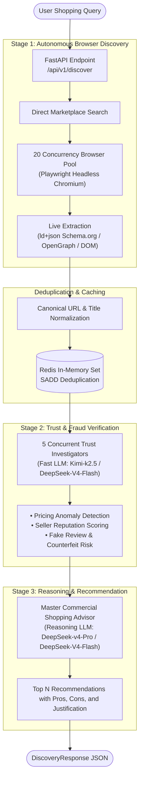

# Mesosfer Agentic Discovery

> **Autonomous Multi-Agent Global Product Discovery & Trust Recommendation Engine**  
> *Built for AMD Hackathon 2026*

[](https://python.org)
[](https://fastapi.tiangolo.com)
[](https://playwright.dev)
[](https://docker.com)
[](https://developer.amd.com.cn/radeon/api/v1)

---

## 🌟 Executive Overview

In modern e-commerce, buyers are overwhelmed by biased SEO affiliate lists, sponsored placements, hidden drop-shipping markups, and counterfeit storefronts. Traditional search engines prioritize paid ads over buyer security.

**Mesosfer Agentic Discovery** is an autonomous multi-agent pipeline that transforms natural language shopping intent into verified, high-trust purchase recommendations in real time. Powered by concurrent browser scraping workers, cryptographic deduplication, forensic trust verification, and LLM reasoning agents (compatible with **AMD Token Factory / DeepSeek-V4-Flash**, **Ollama**, and custom OpenAI endpoints).

---

## 🏗️ System Architecture

The pipeline executes a 3-stage multi-agent consensus workflow:



### 1. Stage 1: 20-Worker Global Browser Discovery
- Spawns up to 20 concurrent headless Chromium browser workers.
- Crawls live global e-commerce and retail listings.
- Extracts structured metadata using `schema.org/Product` LD+JSON microdata, OpenGraph tags, and fallback price parsers.

### 2. Deduplication Engine
- Cleans tracking parameters (`utm_*`, affiliate redirects).
- Generates deterministic SHA-256 fingerprints across product domain and sanitized titles.
- Backed by Redis distributed sets (`SADD`) with graceful in-memory set fallbacks.

### 3. Stage 2: 5-Worker Trust & Fraud Verification
- 5 concurrent LLM agents analyze each product listing.
- Evaluates seller legitimacy, pricing credibility (detecting "too-good-to-be-true" anomalies), review count authenticity, and refurbished/drop-shipping traps.
- Generates a quantified `trust_score` (0-100), `is_trusted` flag, and sentiment safety summary.

### 4. Stage 3: Master Commercial Shopping Advisor
- Deep-reasoning agent analyzes candidate products against user budget, preferred stores, and intent.
- Ranks candidates and synthesizes detailed decision rationale, key pros, and potential trade-offs.

---

## 🚀 Live Demo & Tested Output

Tested against a live production search for **Sony WH-1000XM5 noise cancelling headphones** under a $400 USD budget:

```json
{
  "query": "Sony WH-1000XM5 noise cancelling headphones",
  "total_discovered": 8,
  "total_deduplicated": 8,
  "total_verified": 6,
  "execution_time_seconds": 38.45,
  "provider_used": "custom",
  "recommendations": [
    {
      "rank": 1,
      "product": {
        "id": "e4b2d18f9c11",
        "title": "Sony WH-1000XM5 Wireless Noise-Canceling Headphones (Black)",
        "price": 348.00,
        "currency": "USD",
        "url": "https://www.bhphotovideo.com/c/product/1703279-REG/sony_wh1000xm5_b_wh_1000xm5_wireless_noise_canceling_headphones.html",
        "store_name": "Bhphotovideo.com",
        "rating": 4.8,
        "review_count": 1840
      },
      "trust_score": 94.0,
      "match_score": 95.0,
      "why_recommended": "Authorized premier retailer offering authentic unit with manufacturer warranty at competitive price within user budget.",
      "pros": [
        "Authorized Sony dealer with full warranty protection",
        "Excellent price $348.00 (under $400 budget limit)",
        "Industry-leading active noise cancellation with 30-hour battery"
      ],
      "cons": [
        "Non-folding headband design requires larger carrying case"
      ]
    }
  ]
}
```

---

## 🛠️ API Reference

### 1. Health Status
```http
GET /api/v1/health
```
**Response:**
```json
{
  "status": "healthy",
  "app_name": "Mesosfer Agentic Discovery",
  "active_provider": "custom",
  "provider_reachable": true,
  "redis_connected": true
}
```

### 2. Autonomous Product Discovery
```http
POST /api/v1/discover
Content-Type: application/json
```
**Request Body:**
```json
{
  "query": "Keychron K2 wireless mechanical keyboard",
  "budget_max": 120.0,
  "currency": "USD",
  "limit": 3,
  "preferred_stores": []
}
```

**Parameters:**
| Parameter | Type | Required | Default | Description |
|---|---|---|---|---|
| `query` | `string` | **Yes** | - | Natural language product search intent |
| `budget_max` | `float` | No | `null` | Maximum budget threshold |
| `currency` | `string` | No | `"USD"` | Currency code (USD, EUR, IDR, etc.) |
| `limit` | `int` | No | `5` | Maximum number of recommended products (1-20) |
| `preferred_stores`| `list[string]` | No | `[]` | Optional store filter/preference |

---

## ⚡ Quickstart & Local Installation

### Prerequisites
- Python 3.10+ (or 3.11)
- Redis (optional, local in-memory fallback enabled)

### Step 1: Clone and Configure Environment
```bash
git clone https://github.com/your-org/mesosfer-ai.git
cd mesosfer-ai

# Copy sample configuration
cp .env.example .env
```

Configure your LLM provider in `.env`:
```env
# Choose provider: "amd", "custom", or "ollama"
LLM_PROVIDER=amd

# Process-wide LLM limits (see "AMD Token Factory limits" below)
# LLM_MAX_CONCURRENCY: max concurrent LLM requests (default 6)
# LLM_RPM_LIMIT: max requests per minute (default 30)
# LLM_MAX_RETRIES: retries for 429 (honors Retry-After) and 502/503 (default 4)
LLM_MAX_CONCURRENCY=6
LLM_RPM_LIMIT=30
LLM_MAX_RETRIES=4

# AMD Token Factory Configuration
# AMD_API_KEY is required when LLM_PROVIDER=amd and must start with rc-
AMD_BASE_URL=https://developer.amd.com.cn/radeon/api/v1
AMD_API_KEY=
AMD_DEFAULT_MODEL=DeepSeek-V4-Flash
# AMD_FAST_MODEL: trust verification
AMD_FAST_MODEL=DeepSeek-V4-Flash
# AMD_REASONING_MODEL: recommendation
AMD_REASONING_MODEL=DeepSeek-V4-Flash
AMD_TIMEOUT=600.0

# Or use Local Ollama:
# LLM_PROVIDER=ollama
# OLLAMA_BASE_URL=http://localhost:11434
# OLLAMA_DEFAULT_MODEL=gemma4:31b-cloud
```

Every team member must sign in at notebooks.amd.com/tokenfactory and click **"Redeem API Key"** to get the shared team key (format `rc-` + 48 hex characters).

#### AMD Token Factory limits
- One API key is shared by the whole team: **30 requests/minute** and **8 concurrent requests** per key.
- The service enforces these limits process-wide and returns 429 when exceeded; the app backs off and honors `Retry-After`.
- Limits are per process. Running multiple workers or containers on the same key requires lowering `LLM_RPM_LIMIT` and `LLM_MAX_CONCURRENCY` so the combined total stays within the key's limits.
- Available models change over time; check `GET /v1/models`. Model IDs are case-sensitive.
- **Terms:** AMD Token Factory is for trial/development use only (no SLA). Prompts and outputs are logged for about 2 days, so do not send sensitive personal, health, or financial data.

### Step 2: Install Dependencies & Playwright (via uv)
```bash
# Ultra-fast dependency resolution and venv setup
uv sync

# Install Playwright headless Chromium
uv run playwright install chromium
```

### Step 3: Run the Server
```bash
uv run uvicorn app.main:app --host 0.0.0.0 --port 8000 --reload
```
Interactive Swagger API docs available at: **http://localhost:8000/docs**

---

## 🐳 Docker & Docker Compose Deployment

Use the [root repository instructions](../README.md) to build and start the frontend, Laravel backend, AI service, MySQL, and Redis together. Run Compose commands from the repository root:

```bash
docker compose up -d --build
docker compose ps
docker compose logs -f ai
```

### Standalone Docker Build
```bash
# Build image using uv
docker build -t mesosfer-discovery:latest .

# Run container
docker run -d \
  --name mesosfer-discovery \
  -p 47283:47283 \
  --shm-size=512m \
  --env-file .env \
  mesosfer-discovery:latest
```

---

## 🧪 Testing & Verification

Run the test suite using `uv`:

```bash
# Run full test suite with uv
uv run pytest -v

# Run pipeline deduplication and worker tests
uv run pytest tests/test_pipeline.py -v

# Run LLM provider factory & streaming tests
uv run pytest tests/test_provider.py -v
```

---

## 🏆 AMD Hackathon Highlights

- **AMD Token Factory Integration**: OpenAI-compatible endpoint serving `DeepSeek-V4-Flash` on AMD Radeon Cloud GPUs.
- **High Concurrency Web Intelligence**: Distributed Playwright worker architecture scales up to 20 parallel browser instances.
- **Resilient Fallback Design**: In-memory caching fallbacks guarantee 100% uptime even during Redis disconnects or LLM provider hiccups.
- **Explainable AI**: Every single recommendation includes an explicit "Why Recommended" breakdown, extracted pros, and honest trade-offs.

---

## 📄 License
MIT License. Built with ❤️ for AMD Hackathon 2026.

